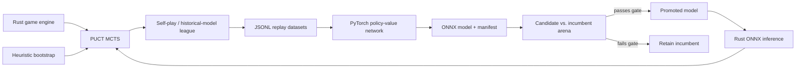

# CascadeZero

**An AlphaZero-inspired reinforcement learning agent for Cascade, combining a Rust game engine and Monte Carlo tree search with PyTorch policy-value learning and ONNX inference.**

CascadeZero implements the full improvement loop: generate games, learn from search policies and game outcomes, export a candidate network, evaluate it against the incumbent, and promote it only when it passes an arena gate. A historical-model league adds opponent diversity across iterations.

The project brings together **search algorithms, systems programming, deep learning, model deployment, and experiment orchestration** in one codebase.

Cascade is a two-player strategy game on an 8×8 board. Players first place stacks, then move, merge, capture, or spread a stack along a direction, pushing occupied cells and potentially ejecting pieces from the board. The engine handles elimination, repetition, stalemate, and turn-limit adjudication.

## Technical highlights

| Area | Implementation |
| --- | --- |
| Game simulation | Rust rules engine for an 8×8 board, placement and play phases, stack movement, captures, cascade propagation, repetition tracking, and terminal adjudication. |
| Search | PUCT-based MCTS with policy priors, player-relative value backup, visit-count action selection, temperature scheduling, and root Dirichlet noise scaled by legal-action count. |
| Representation | 832 discrete actions with legal-action masks; 32 feature planes with player-relative rotation, stack-height buckets, local tactical features, and cascade coverage. |
| Learning | Configurable residual CNN with separate policy and value heads; masked policy cross-entropy plus outcome regression; AdamW, checkpoint warm starts, and optional mixed precision. |
| Model deployment | PyTorch → ONNX → Rust ONNX Runtime, with versioned manifests, tensor validation, and CPU, CUDA, or ROCm execution-provider selection. |
| Data generation | Rayon-based parallel games plus Python process workers with separate inference contexts, deterministic seed assignment, JSONL shards, and merged reports. |
| Iterative improvement | Candidate/incumbent arena gates, paired color-swapped evaluation, bounded replay windows, age-decayed dataset sampling, and a rolling historical/elite opponent pool. |
| Observability | Structured training summaries, per-round arena reports, command logs, search-node counts, timing, and throughput metrics. |

## Architecture



Rust owns game simulation, search, and evaluation. Python owns training, export, replay scheduling, and the experiment loop. The runtime boundary is an ONNX model bundle rather than a Python process embedded in the search engine. The Rust crate is named `cascade_data`; the Python package is `cascade_zero`.

### Search and learning

The action space contains **64 placements + 256 moves + 256 captures + 256 cascades**. Search expands legal actions using evaluator priors and backs up values from the current player's perspective. A small `0.999` discount on backed-up values favors shorter winning lines. During data generation, exploration combines visit-count sampling with root noise; evaluation uses a configurable stochastic opening followed by greedy visit-count selection.

Each training example records the board snapshot, legal action statistics, search policy, root value, and eventual game outcome. The network receives a **32 × 8 × 8** tensor and produces **832 policy logits** plus a scalar value in **[−1, 1]**. Both encoders use the `height_buckets_v2` feature layout; blue-to-move positions and policy targets are rotated into the current player's perspective.

The training objective is:

```text
loss = policy_loss_weight × CE(search_policy, masked_policy_logits)
     + value_loss_weight  × MSE(predicted_value, outcome_target)
```

An optional experimental **mHC block** replaces standard residual blocks with grouped convolutions and a learned stream-mixing matrix normalized by log-space Sinkhorn iterations. Export folds the mixer into a 1×1 convolution. Standard residual blocks are the default; no strength advantage is claimed for the experimental variant.

### Promotion and replay

The iteration runner trains a candidate, exports it, and plays an arena against the current incumbent. Promotion requires both the configured score threshold and minimum number of wins. Arena score is **(wins + 0.5 × draws) / games**, so it is distinct from win rate.

Accepted models become the next incumbent and can enter the historical opponent pool. Replay can retain a bounded window of datasets and weight older data by `replay_decay ** age`. The league runner supports color-swapped opponent pairs and recording candidate-side moves separately from league-side moves.

## Quick start

Use a Rust toolchain with Cargo and Python 3.10 or newer. The examples below run on CPU. No trained weights are required for heuristic self-play.

```bash
git clone https://github.com/TobyX424242/cascadeZero.git
cd cascadeZero
cargo build --release --locked --bins
cargo test --locked --all-targets
```

Generate an initial dataset with the built-in heuristic evaluator:

```bash
mkdir -p artifacts
cargo run --release --locked --bin selfplay -- \
  --games 32 --simulations 64 --threads 2 --seed 42 \
  --output artifacts/selfplay.jsonl
```

Install the training and export dependencies, then train a network:

```bash
python3 -m venv .venv
source .venv/bin/activate
python -m pip install --upgrade pip
python -m pip install -e '.[export]'
python scripts/train_teacher_resnet.py --config configs/training.json
```

Export the best checkpoint for CPU inference:

```bash
python scripts/export_teacher_resnet.py \
  --checkpoint artifacts/training/best.pt \
  --output-dir artifacts/model \
  --execution-provider cpu
```

Rust loads ONNX Runtime dynamically. On Linux, point it at the shared library installed with the Python runtime package:

```bash
export ORT_DYLIB_PATH="$(python - <<'PY'
from pathlib import Path
import onnxruntime

capi = Path(onnxruntime.__file__).resolve().parent / 'capi'
libraries = sorted(capi.glob('libonnxruntime.so*'))
if not libraries:
    raise SystemExit('Set ORT_DYLIB_PATH to your ONNX Runtime shared library.')
print(libraries[0])
PY
)"
```

Evaluate the network against the heuristic baseline with equal search budgets:

```bash
cargo run --release --locked --bin arena -- \
  --player-a-name heuristic \
  --player-b-name candidate \
  --player-b-model artifacts/model/teacher_resnet_onnx.json \
  --games 20 --simulations 64 --threads 2 --seed 42 \
  --report-json artifacts/arena_report.json
```

Keep the export manifest, `.onnx` file, and any `.onnx.data` sidecar together. The manifest carries the feature layout, tensor names, provider, and relative artifact paths.

## Automated training loop

After installing dependencies and setting `ORT_DYLIB_PATH`, run a small pipeline check:

```bash
python scripts/run_teacher_iteration.py --config configs/smoke.json
```

This generates two heuristic games, trains a tiny network for one epoch, exports it, and runs a two-game arena. It checks pipeline wiring; it does not measure playing strength, and promotion is not required for the check to complete.

For a longer run:

```bash
# Gated self-play iteration
python scripts/run_teacher_iteration.py --config configs/iteration.json

# Gated iteration with a historical-model league
python scripts/run_teacher_iteration_leagueplay.py --config configs/leagueplay.json

# Ungated bootstrap rounds before arena evaluation
python scripts/run_teacher_warmup.py --config configs/warmup.json
```

| Configuration | Purpose |
| --- | --- |
| `configs/training.json` | Standard 6-block, 64-channel residual network and training settings. |
| `configs/iteration.json` | Three CPU rounds with heuristic bootstrap, arena gating, and decayed replay. |
| `configs/leagueplay.json` | Iteration plus a rolling pool of accepted opponents; the initial empty pool is skipped. |
| `configs/warmup.json` | Three training/self-play rounds without promotion gates. |
| `configs/smoke.json` | One minimal CPU pipeline round using `training_smoke.json`. |

All examples use repository-relative paths and write generated files under `artifacts/`. Set `dataset_path` to start iteration from an existing dataset. Set `arena.baseline_model` and `training.init_checkpoint` to continue from an exported incumbent and its checkpoint. The initialization checkpoint must match the requested network configuration.

For larger data-generation jobs, `scripts/run_parallel_selfplay.py` and `scripts/run_parallel_leagueplay.py` split games across processes and merge their outputs. Size worker counts to available CPU, memory, and accelerator capacity; more workers are not guaranteed to improve throughput.

### GPU execution

Install a PyTorch build and ONNX Runtime distribution matching your CUDA or ROCm environment. The `export` extra installs the CPU ONNX Runtime package; replace it with the matching accelerator distribution when using a GPU provider. Set `ORT_DYLIB_PATH` to that runtime's shared library and make its device libraries available to the dynamic loader.

For automated runs, set `training.device` to `cuda` (also used by PyTorch on ROCm) and `training.execution_provider` to `cuda` or `rocm`. Enable `amp` and `channels_last` in the referenced training config if appropriate. For manual export, pass the matching `--execution-provider`. GPU manifests default to failing when the requested provider cannot initialize; CPU fallback requires an explicit manifest setting.

## Agent integration

The `interactive` binary provides a newline-delimited JSON protocol over stdin/stdout. Supported commands are `init`, `state`, `step`, and `ai_step`:

```bash
printf '%s\n' \
  '{"cmd":"init","simulations":64}' \
  '{"cmd":"ai_step"}' \
  '{"cmd":"state"}' \
  | cargo run --release --locked --bin interactive
```

Include a `model` manifest path in `init` to use neural inference. Responses expose the current state and legal actions, making the engine usable from an external game client without coupling that client to the training stack.

## Repository layout

```text
src/
  engine.rs, model.rs       Rules, state, action encoding, and sample schemas
  mcts.rs, eval.rs          Tree search and heuristic evaluation
  neural.rs                Feature encoding and model inference
  selfplay.rs, collector.rs Data generation and policy/outcome targets
  arena.rs, leagueplay.rs   Evaluation and historical-opponent games
  bin/                     selfplay, arena, leagueplay, interactive
python/cascade_zero/
  teacher_features.py       Python feature encoder and action rotation
  teacher_training.py       Networks, dataset loading, losses, and ONNX export
scripts/                   Training, export, and iteration/process runners
configs/                   Portable CPU examples and smoke settings
```

## Validation and scope

The existing Rust tests cover placement legality, cascade propagation, search behavior and root exploration, feature planes, legal-policy normalization, arena pairing, and league sample collection. GitHub Actions is configured to run these tests and a CPU training/export/arena smoke round.

This is a research implementation inspired by the AlphaZero training loop. It uses a heuristic bootstrap and engineered tactical features. Example configurations are starting points for experiments. Pretrained checkpoints, datasets, benchmark results, and claims of competitive strength are not included. CPU/GPU numerical behavior and throughput depend on the selected runtime and hardware; fixed seeds do not imply bitwise determinism across devices.

## License

[MIT](LICENSE).
